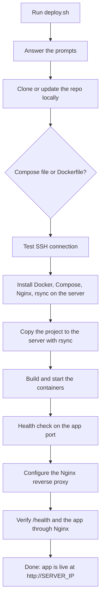

# Automated Docker Deployment Script (Bash)

A Bash script that deploys a containerized application to a remote Linux server with a single command. You answer a few prompts (Git repo, server IP, SSH details), and the script does the rest: it clones your code, connects to the server over SSH, installs Docker and Nginx, ships your project across, starts the containers, and puts Nginx in front of the app as a reverse proxy.

---

## Table of Contents

1. [What this project does](#what-this-project-does)
2. [Key terms for beginners](#key-terms-for-beginners)
3. [How it works](#how-it-works)
4. [Project structure](#project-structure)
5. [Prerequisites](#prerequisites)
6. [Quick start](#quick-start)
7. [What the script asks you](#what-the-script-asks-you)
8. [Example run](#example-run)
9. [Step-by-step: what happens behind the scenes](#step-by-step-what-happens-behind-the-scenes)
10. [Two deploy modes: Compose or Dockerfile](#two-deploy-modes-compose-or-dockerfile)
11. [The Nginx reverse proxy](#the-nginx-reverse-proxy)
12. [Logging](#logging)
13. [Security notes](#security-notes)
14. [Running it again (re-deploys)](#running-it-again-re-deploys)
15. [Troubleshooting](#troubleshooting)
16. [Known limitations](#known-limitations)
17. [Ideas for future improvements](#ideas-for-future-improvements)
18. [Author](#author)

---

## What this project does

Deploying an app by hand means many repeated steps: log in to the server, install Docker, copy files, run containers, set up a web server. This script automates all of it.

**In one run, it will:**

- Ask for the details it needs and check that your answers look valid
- Clone your Git repository (or pull the latest changes if it was already cloned)
- Detect whether your project uses `docker-compose` or a plain `Dockerfile`
- Test the SSH connection to your server
- Install Docker, Docker Compose, Nginx and rsync on the server
- Copy your project to the server
- Build and start your containers
- Wait until the app answers, then show logs if it doesn't
- Configure Nginx so people can reach your app on normal web port 80
- Write every step to a timestamped log file

---

## Key terms for beginners

| Term | Plain-English meaning |
|------|----------------------|
| **Server** | A computer that is always on and reachable over the internet (for example an AWS EC2 instance). |
| **SSH** | A secure way to log in to and run commands on a remote server from your own terminal. |
| **SSH key** | A file that proves who you are to the server, used instead of a password. |
| **Git repository (repo)** | A project folder tracked by Git, usually hosted on GitHub. |
| **PAT (Personal Access Token)** | A password-like token from GitHub that lets the script download your repo, including private ones. |
| **Docker / container** | A way to package an app and everything it needs so it runs the same everywhere. A running package is called a container. |
| **Dockerfile** | A recipe that tells Docker how to build your app's image. |
| **Docker Compose** | A tool that starts one or more containers from a single `docker-compose.yaml` file. |
| **Nginx** | A web server. Here it acts as a reverse proxy. |
| **Reverse proxy** | A middleman. Visitors talk to Nginx on port 80, and Nginx passes the request to your app on its own port. |
| **Port** | A numbered door on a computer. Web traffic normally uses 80 (HTTP), SSH uses 22. |
| **rsync** | A tool that copies folders efficiently and can keep two folders identical. |

---

## How it works



The script runs on **your machine**. Your machine talks to the **server** over SSH, so you never log in to the server manually.

---

## Project structure

```
.
├── deploy.sh        # Main script: the deployment steps and the main flow
├── config.sh        # Settings, logging helpers, input validation and prompts
├── .gitignore       # Keeps logs and the cloned repo out of Git
└── README.md
```

Created when you run the script (both are listed in `.gitignore`):

```
├── deployed_repo/                  # Your app's repo, cloned locally
└── deployment_YYYYMMDD_HHMMSS.log  # One log file per run
```

`deploy.sh` loads `config.sh` automatically, so keep both files in the same folder.

---

## Prerequisites

### On your own machine (where you run the script)

- Linux, macOS, or Windows with WSL, using **Bash**
- These tools installed: `git`, `ssh`, `rsync`, `curl`

Check quickly:

```bash
git --version && ssh -V && rsync --version | head -1 && curl --version | head -1
```

Install anything missing on Ubuntu/Debian:

```bash
sudo apt update && sudo apt install -y git openssh-client rsync curl
```

### On the server

- Ubuntu or Debian (the script uses `apt`)
- A user that can run `sudo` **without typing a password** (the default `ubuntu` user on AWS EC2 can)
- Your SSH public key already added to that user, so you can log in with a key
- Firewall or cloud security group allowing inbound:
  - **Port 22** (SSH)
  - **Port 80** (HTTP, so you can view the app in a browser)
- Port 80 not already used by another web server

### Things you need to have ready

- The **HTTPS URL** of your Git repository, for example `https://github.com/your-username/your-repo.git`
- A **GitHub Personal Access Token** (see below)
- The server's **public IP address**
- The **path to your SSH private key**, for example `~/.ssh/my-key.pem`
- A repo that contains a `docker-compose.yaml` (or `.yml`) **or** a `Dockerfile` at its top level

#### Creating a GitHub token

1. On GitHub, go to **Settings → Developer settings → Personal access tokens**.
2. Create a token that can **read repository contents** (a fine-grained token with read-only *Contents* access to the one repo is enough).
3. Copy it right away. GitHub only shows it once.

### One-time setup before the first run

Two things trip up almost every first run:

```bash
# 1. Your key file must not be readable by others
chmod 600 ~/.ssh/my-key.pem

# 2. Connect once by hand so your machine remembers the server (type "yes" when asked)
ssh -i ~/.ssh/my-key.pem ubuntu@YOUR_SERVER_IP
exit
```

The script tests SSH in a mode that cannot answer questions, so an unknown server would make the test fail. Connecting once by hand fixes that.

---

## Quick start

```bash
# 1. Get the scripts
git clone https://github.com/<your-username>/<this-repo>.git
cd <this-repo>

# 2. Make the main script executable
chmod +x deploy.sh

# 3. Run it
./deploy.sh
```

Answer the prompts. When the script finishes, open `http://YOUR_SERVER_IP` in your browser.

---

## What the script asks you

| Prompt | Example | Notes |
|--------|---------|-------|
| **Git Repository URL** | `https://github.com/you/app.git` | Must start with `https://`. |
| **Personal Access Token** | *(hidden as you type)* | Not shown on screen and not saved in the cloned repo. |
| **Branch name** | `main` | Press Enter to use the default, `main`. |
| **SSH username** | `ubuntu` | The user on the server. |
| **Server IP address** | `203.0.113.10` | Format is checked, for example `x.x.x.x`. |
| **SSH private key path** | `~/.ssh/my-key.pem` | `~` is expanded for you. The file must exist. |
| **App port** | `9600` | The port your app is published on **on the server**. See below. |

### Which number do I enter for the port?

Enter the **left** number of the `ports:` line in your `docker-compose.yaml`:

```yaml
ports:
  - "9600:9600"
#    ^^^^
#    this one: the port on the server
```

Nginx forwards visitors to this port. If it does not match your compose file, the script's health check fails and tells you so.

If your project has only a Dockerfile, the script publishes the port for you, so enter the port your app listens on **inside** the container (for example `9600` for the sample Dockerfile below).

If you type something invalid (for example `abc` as an IP), the script warns you and asks again. It does not quit.

---

## Example run

```text
=====================================================
             Deployment Script Initialized
=====================================================
[INFO] 2026-11-24 10:15:02 All logs are being recorded in: /home/you/project/deployment_20261124_101502.log
[INFO] 2026-11-24 10:15:02 --- Starting Parameter Collection ---
Enter Git Repository URL: https://github.com/you/app.git
Enter Personal Access Token (PAT):
Enter branch name (Default: main):
[INFO] Using default for BRANCH_NAME: main
Enter Remote Server SSH Username: ubuntu
Enter Remote Server IP Address: 203.0.113.10
Enter Absolute Path to SSH Private Key (e.g., ~/.ssh/id_rsa): ~/.ssh/my-key.pem
Enter the app port on the server (the left number in docker-compose 'ports', e.g. 9600): 9600
[SUCCESS] --- Parameter Collection Complete ---
...
[INFO] Deploy mode: compose
[INFO] Attempting to SSH into remote server ubuntu@203.0.113.10...
[SUCCESS] SSH connection to 203.0.113.10 succeeded.
...
[INFO] Checking that the app answers on port 9600 (from inside the server)...
[SUCCESS] Dockerized application deployed successfully.
[SUCCESS] Nginx configured successfully as a reverse proxy.
[SUCCESS] Deployment finished. App is available at http://203.0.113.10
```

---

## Step-by-step: what happens behind the scenes

1. **Collect and validate input.** Each answer is checked (URL starts with `https://`, IP has a valid shape, port is 1 to 65535, key file exists). A bad answer means a warning and a new prompt.
2. **Clone or update the repo.** If `deployed_repo/` does not exist, the script clones the branch you chose. If it exists, it pulls the latest changes. Your token is used only for that git command and is **removed from the saved repo settings afterwards**.
3. **Detect the deploy mode.** A `docker-compose.yaml` or `.yml` means *compose* mode. Otherwise a `Dockerfile` means *dockerfile* mode. If neither exists, the script stops with a clear message.
4. **Test SSH.** A quick `echo` over SSH with a 10-second timeout. If it fails, nothing else runs.
5. **Prepare the server.** Runs `apt update`, installs `docker.io`, `docker-compose`, `nginx` and `rsync`, adds your user to the `docker` group, enables and starts Docker and Nginx, then prints each tool's version to confirm.
6. **Copy the project.** `rsync` copies the whole project into `~/app` on the server, skipping the `.git` folder. It also removes files on the server that you have deleted from the repo, so the server always matches.
7. **Build and start.** Compose mode runs `docker-compose up -d --build`. Dockerfile mode builds an image and runs a container named `app_container`. Either way it rebuilds, so code changes are picked up.
8. **Health check.** From inside the server, the script calls the app on your port up to **6 times, 5 seconds apart**, because containers take a few seconds to start. If it never answers, the script prints the container status and recent logs, then stops.
9. **Configure Nginx.** Writes a reverse proxy config, tests it with `nginx -t`, and reloads Nginx.
10. **Final checks.** Calls `/health` and the home page through Nginx. If both answer, the deployment is done.

---

## Two deploy modes: Compose or Dockerfile

The script detects the mode automatically. If your repo has both, **compose wins**.

### Compose mode

Use this when your repo has a `docker-compose.yaml`. Example:

```yaml
services:
  web:
    build: .
    container_name: bash_deploy
    ports:
      - "9600:9600"
    restart: unless-stopped
```

### Dockerfile mode

Use this when your repo has only a `Dockerfile`. Example (a tiny static site served on port 9600):

```dockerfile
FROM alpine:latest
RUN apk add --no-cache busybox-extras
COPY index.html /index.html
EXPOSE 9600
CMD ["sh", "-c", "httpd -f -p 9600 -h /"]
```

The script then runs `docker build -t app_image .` and starts the container with `-p <port>:<port>`.

---

## The Nginx reverse proxy

The script writes `/etc/nginx/conf.d/reverse-proxy.conf` on the server:

```nginx
server {
    listen 80;
    server_name <SERVER_IP>;

    location / {
        proxy_pass http://localhost:<APP_PORT>;
        proxy_set_header Host $host;
        proxy_set_header X-Real-IP $remote_addr;
        proxy_set_header X-Forwarded-For $proxy_add_x_forwarded_for;
        proxy_set_header X-Forwarded-Proto $scheme;
    }

    location /health {
        return 200 "OK\n";
        add_header Content-Type text/plain;
    }
}
```

- `http://SERVER_IP/` shows your app.
- `http://SERVER_IP/health` answers `OK` and is handy for monitoring tools.
- The file is replaced on every run, so it always matches the port you entered.

---

## Logging

Every message is printed in color on screen and also saved to:

```
deployment_YYYYMMDD_HHMMSS.log
```

in the same folder as the scripts, so each run gets its own file. Message types:

| Label | Meaning |
|-------|---------|
| `INFO` (blue) | Normal progress |
| `SUCCESS` (green) | A step finished well |
| `WARN` (yellow) | Something is wrong with your input, and you are asked again |
| `ERROR` (red) | A step failed and the script stops |

If something goes wrong, open the newest log file first.

---

## Security notes

- **The token is hidden** while you type it and is never printed in the configuration summary.
- **The token is not left on disk.** After cloning or pulling, the saved remote address in `deployed_repo/.git/config` is reset to the plain URL.
- **No `eval` on user input.** Your answers are stored as plain text and never run as commands.
- **Never commit** your SSH key, your token, or the log files. `.gitignore` already covers the logs and `deployed_repo/`.
- **Use a read-only, short-lived token** where you can, and delete it from GitHub when you no longer need it.
- Opening only ports **22** and **80** in your firewall is enough. Your app's own port does not need to be public because Nginx forwards traffic to it.

---

## Running it again (re-deploys)

You can run `./deploy.sh` as many times as you like:

- Already-installed packages are skipped by `apt`.
- The local repo is updated with a pull instead of cloned again.
- `rsync` makes `~/app` on the server match your repo exactly.
- Containers are rebuilt, so new code goes live.
- The Nginx config is rewritten and reloaded.

There is no automatic rollback. If a deploy fails, the script prints the container status and logs to help you fix the problem, and then you run it again.

---

## Troubleshooting

| What you see | Likely cause | Fix |
|--------------|--------------|-----|
| `SSH connection ... failed` right at the start | Server not yet known to your machine, wrong IP, or closed port 22 | Run `ssh -i <key> <user>@<ip>` once by hand and answer `yes`. Check the IP and the firewall. |
| `Permission denied (publickey)` | Wrong username or wrong key | Use the right user (`ubuntu`, `ec2-user`, etc.) and the key matching the server. |
| `UNPROTECTED PRIVATE KEY FILE` | Key file is too open | `chmod 600 <your-key>` |
| `Failed to clone repository` | Wrong URL, branch, or token | Use an `https://` URL, check the branch name, and make sure the token can read the repo. |
| `Failed to update package lists` or `Could not get lock` | A brand-new server is still running its own updates | Wait a minute or two and run again. |
| A `sudo` command asks for a password and hangs | The server user does not have passwordless sudo | Use a user with passwordless sudo, such as the default cloud user. |
| `rsync: command not found` | rsync missing on your machine | `sudo apt install rsync` |
| `No Dockerfile or docker-compose file found` | The repo root has neither file | Add one at the top level of the repo. |
| `App is not answering on port ...` | The port you entered does not match the app | Check the **left** number of `ports:` in `docker-compose.yaml` and run again. The container logs printed just above explain the app's own errors. |
| Script says success, but the browser can't load the page | Port 80 is blocked | Allow inbound port 80 in your firewall or cloud security group. |
| `502 Bad Gateway` in the browser | Nginx is up, the app is not | On the server run `docker ps` and `docker logs <container>`. Confirm the port. |
| Nginx fails to start or reload | Another program already uses port 80 | Stop the other service or free port 80. |

---

## Known limitations

- Works on **Debian/Ubuntu** servers only (it relies on `apt`).
- Only **`https://` repository URLs** work for cloning, because the token is placed into the URL. The input check also accepts `http://` and `git://`, but those will not clone.
- The IP check verifies the *shape* of the address, not that each number is 0 to 255.
- Nginx is set up for plain **HTTP**. HTTPS and certificates are not included.
- One app per server: the Nginx config file is overwritten on each run.
- No automatic **rollback** to a previous version.
- The script needs passwordless `sudo` on the server.

---

## Ideas for future improvements

- Add HTTPS with Let's Encrypt (Certbot) and a domain name
- Accept inputs as command-line flags or a `.env` file for use in CI/CD
- Tag images with versions to allow rollback
- Support more than one app and domain on the same server
- Add a `--dry-run` mode that shows what would happen without changing anything
- Add ShellCheck and automated tests to a GitHub Actions workflow

---

## Author

**Gerald Izuchukwu**
GitHub: [Gerald-Izuchukwu](https://github.com/Gerald-Izuchukwu)